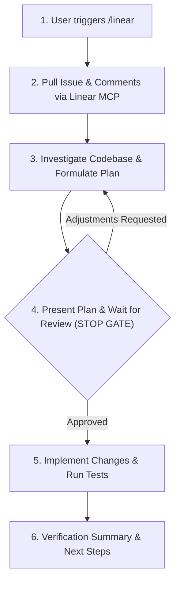

# Linear Issue Workflow (`/linear`)

Use this skill whenever the user invokes `/linear`, provides a Linear issue ID, or asks to investigate, plan, and implement a Linear ticket.

The workflow follows a strict 5-stage lifecycle with a **mandatory human-in-the-loop checkpoint** between planning and implementation:



---

## Stage 1: Identify the Issue ID

1. Check if the user passed an issue identifier in their prompt (e.g., `/linear LIN-42`, `CL-101`, or a Linear URL).
2. If no issue ID is provided, stop and prompt the user:
   > "Please provide the Linear issue ID or key (e.g., `LIN-123` or `CL-45`)."

---

## Stage 2: Pull Issue Details and Comments

Query the Linear MCP server to get complete context on the ticket.

1. **Retrieve Issue Metadata & Description**:
   Call `call_mcp_tool` with:
   - `ServerName`: `"linear-mcp-server"`
   - `ToolName`: `"get_issue"`
   - `Arguments`:
     ```json
     {
       "id": "<issue_id>",
       "fields": [
         "id",
         "title",
         "description",
         "status",
         "priority",
         "labels",
         "gitBranchName",
         "assignee",
         "attachments",
         "url"
       ]
     }
     ```

2. **Retrieve Discussion & Comments**:
   Call `call_mcp_tool` with:
   - `ServerName`: `"linear-mcp-server"`
   - `ToolName`: `"list_comments"`
   - `Arguments`:
     ```json
     {
       "issueId": "<issue_id>"
     }
     ```
   Check comments for clarifications, acceptance criteria, edge cases, or design notes from teammates.

3. **Handle Attachments / Screenshots**:
   If the description or comments include embedded markdown images or attachments, note them. Use `extract_images` or `get_attachment` if visual inspection is required.

---

## Stage 3: Codebase Research & Plan Formulation

Before writing any code, thoroughly research the local repository:

1. **Locate Relevant Code**:
   - Search for related files, classes, methods, and configurations using workspace tools.
   - Trace existing architecture and data flow.
2. **Identify Test Coverage**:
   - Locate existing unit/widget/integration tests covering the area.
   - Determine what new tests will be required.
3. **Formulate the Implementation Plan**:
   Structure the plan with the following sections:
   - **Ticket Context**: Issue ID, Title, Status, Target Branch (if suggested by Linear).
   - **Problem / Goal**: Concise summary of what needs to be solved or added.
   - **Codebase Findings**: Existing files and architectural touchpoints.
   - **Proposed Changes**:
     - Files to modify (with specific functions/classes).
     - New files or components to create.
     - Key logic or schema changes.
   - **Testing & Verification**:
     - Automated tests to add or run (e.g. `flutter test`, `dart test`, `dart analyze`).
     - Edge cases and validation scenarios.
   - **Risks & Open Questions**: Any trade-offs or assumptions made.

---

## Stage 4: Present Plan & Wait for Adjustments (Mandatory Gate)

> [!IMPORTANT]
> **DO NOT start modifying code at this stage.** You MUST pause and wait for explicit user feedback or approval.

1. Display the implementation plan clearly in markdown.
2. Ask the user for their review:
   > "Here is the implementation plan for **<ISSUE_ID>: <TITLE>**. Please let me know if you would like any adjustments before I begin implementation, or reply **'Proceed'** / **'Approve'** to start."
3. **End turn and wait.** Do not call editing or write tools until the user responds.
4. If the user suggests changes or adjustments:
   - Refine the plan to address the feedback.
   - Re-confirm with the user until alignment is reached.

---

## Stage 5: Implement, Test & Verify

Once the user approves the plan:

1. **(Optional) Branch & Status**:
   - If a `gitBranchName` was provided by Linear and a new branch is desired, check with git.
   - If configured to track progress in Linear, update the issue status to "In Progress" using `save_issue`.
2. **Execute Code Changes**:
   - Apply edits cleanly using `edit_file` and `write_file`.
   - Adhere to existing coding standards, style guidelines, and architecture in the project.
3. **Run Verification & Tests**:
   - Run tests and static analysis (e.g., `flutter test`, `dart analyze`, or the project's test suite).
   - Fix any compiler errors, lint warnings, or broken tests.
4. **Final Delivery**:
   - Provide a concise summary of all changes made.
   - Report test and verification results.
   - Offer to update the Linear issue (add a completion comment or set state to "Done" / "In Review").

